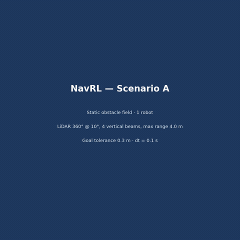
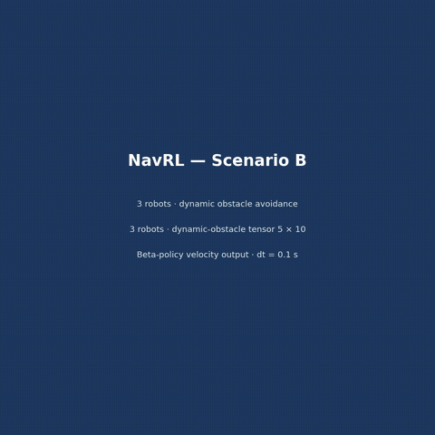
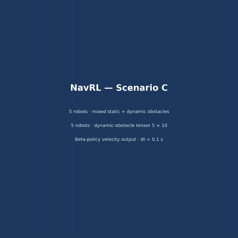
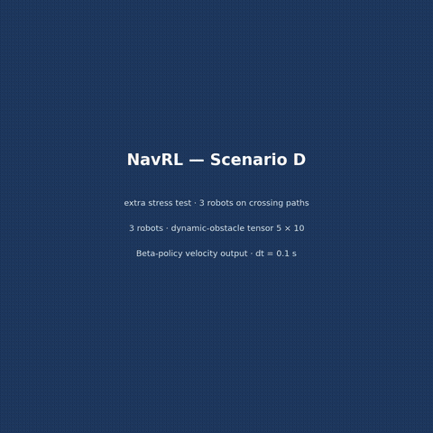
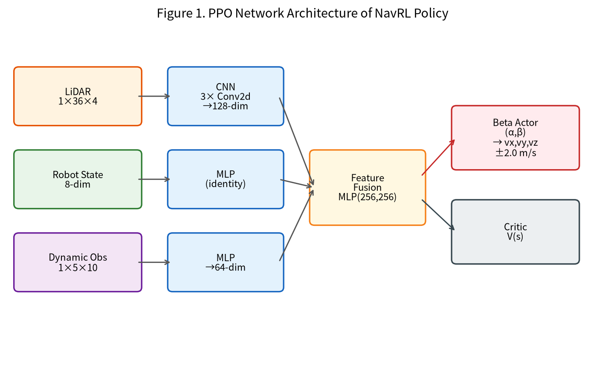
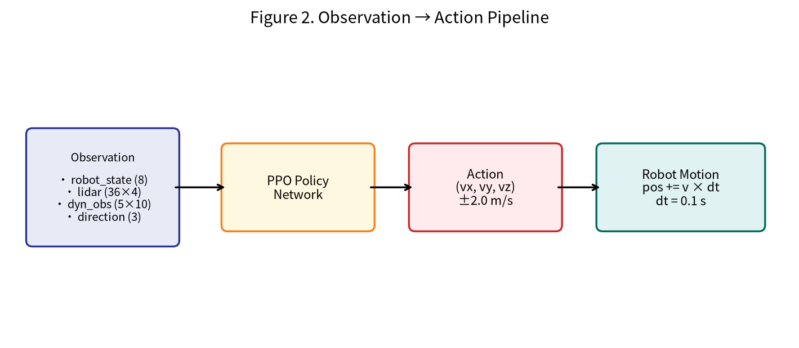
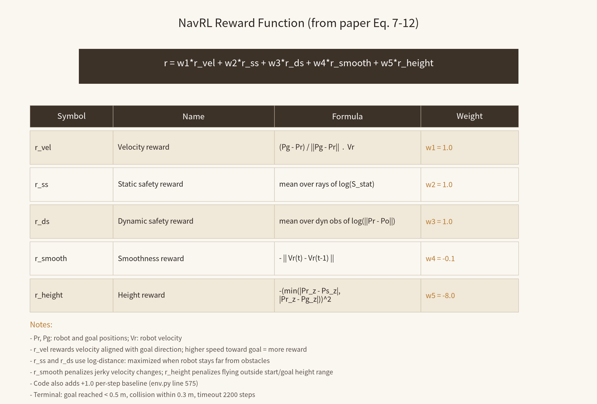
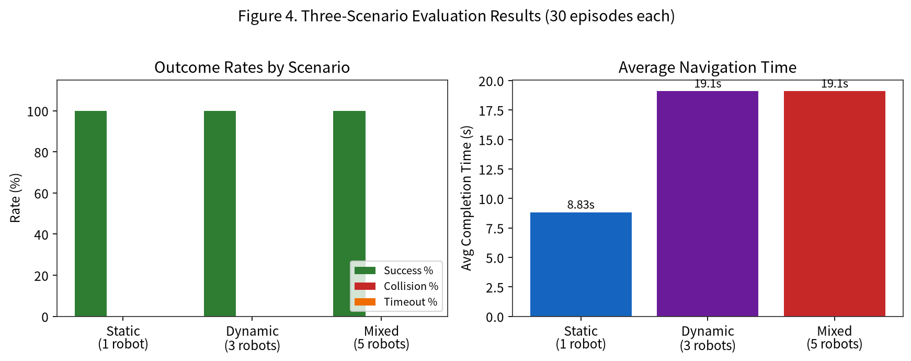
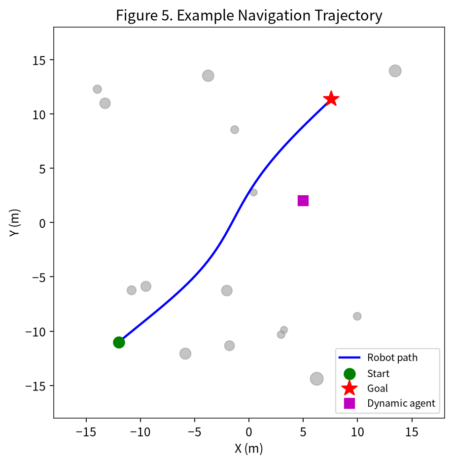

# NavRL Robot Navigation with PPO — Course Project

Evaluation of the released **pretrained NavRL policy** (Xu et al., *NavRL: Learning Safe Flight in
Dynamic Environments*, IEEE RA-L 2025). The checkpoint is used for **inference only — no
retraining**, so every number below is a property of the released model under the protocol
described here.

| Scenario | Robots | Obstacle field | Episodes | Success | Collision |
|---|---|---|---|---|---|
| **A** static | 1 | grid field of static circles, r = 0.3–0.5 m | 30 (seeds 0–29) | 100 % | 0 % |
| **B** multi-robot | 3 | same field, robots are mutual dynamic obstacles | 30 (seeds 0–29) | 100 % | 0 % |
| **C** mixed | 5 | same field, 5 robots crossing together | 30 (seeds 1000–1029) | 100 % | 0 % |

---

## 1. Demo videos

Full demo (84 s, 960 × 960, title card + four segments + summary):
**[NavRL_Demo_Video.mp4](videos/NavRL_Demo_Video.mp4)**

### A — static obstacles, 1 robot (9.3 s, 1/1 reached, 0 collisions)


[full-quality MP4](videos/scenario_A_static_single.mp4)

### B — 3 robots, dynamic obstacle avoidance (19.1 s, 3/3 reached)


[full-quality MP4](videos/scenario_B_multi3.mp4)

### C — 5 robots, mixed obstacles (19.0 s, 5/5 reached)


[full-quality MP4](videos/scenario_C_multi5.mp4)

### D — extra stress test: 3 robots on crossing paths (22.2 s, 3/3 reached)


[full-quality MP4](videos/scenario_D_crossing3.mp4)

The red rays in Scenario A are the live 36-beam LiDAR; the growing lines behind each robot are the
trajectories. Every frame is produced by **the same checkpoint and the same inference code shipped in
this repository** — only the matplotlib animation front-end was replaced by a headless frame writer,
so the policy on screen is the policy that produced the table above.

> Scenario D is a qualitative add-on and is **not** part of the 30-episode × 3-scenario statistics.

---

## 2. Observation and action space

| Key | Shape | Content |
|---|---|---|
| `state` | 8 | unit vector to goal in the goal frame (3) · 2-D distance (1) · z distance (1) · velocity in goal frame (3) |
| `lidar` | 1 × 36 × 4 | 36 beams at 10° (full 360°), 4 vertical beams over −10°…20°, max range 4.0 m, value = r_max − d |
| `direction` | 1 × 3 | unit goal direction, used to rotate the action back to the world frame |
| `dynamic_obstacle` | 1 × 5 × 10 | 5 nearest agents: unit relative position (3), 2-D distance (1), z distance (1), local velocity (3), width/height hints (2) |

**Action:** continuous velocity (v_x, v_y, v_z), Beta-distributed, clipped to ±2.0 m/s.
**Integration:** `pos += v · dt`, `dt = 0.1 s`, limit 600 steps (60 s), goal tolerance 0.3 m.



*LiDAR branch: Conv 4→16→16, stride (2,1)/(2,2), flatten + Linear 128 → 128 features.
Dynamic-obstacle branch: MLP 50→128→64. State passed through. Concatenated 200-dim feature →
MLP 256→256 → Beta actor (α, β) + critic.*



---

## 3. Reward function (verified against source)

The reward is a **dense per-step** signal, not sparse terminal ±10. Verified in
`isaac-training/training/scripts/env.py`, lines 547–580 of the NavRL training code:

$$
r_t = R_{vel} + 1.0 + R_{static} + R_{dyn} - 0.1\,P_{smooth} - 8.0\,P_{height}
$$

| Term | Definition | Sign / behaviour |
|---|---|---|
| `R_vel` | `v · (g − p) / ‖g − p‖` | positive when moving toward the goal |
| alive bonus | constant `+1.0` per step | always positive |
| `R_static` | mean over beams of `log(clip(d, 1e-6, 4.0))` | ≈ +1.39 when all beams clear, → 0 near 1 m, negative below 1 m |
| `R_dyn` | `log(clip(d_nearest, 1e-6, 4.0))` | same shape, nearest moving agent |
| `P_smooth` | `‖v_t − v_{t−1}‖₂` (weight −0.1) | penalises jerky commands |
| `P_height` | height-violation squared (weight −8.0) | 3-D term, identically 0 in this 2-D adaptation |

`R_goal (+10)`, `R_collision (−0.5)` and `R_timeout (−10)` are commented out / absent in the
released code and contribute **0** — success, collision and timeout differ only in whether the robot
keeps collecting shaping reward.



---

## 4. Hyperparameters (from `src/cfg/`)

| Parameter | Value | Source |
|---|---|---|
| learning rate (all modules) | 5e-4 | `ppo.yaml` |
| PPO clip ratio ε | 0.1 | `ppo.yaml` |
| entropy coefficient | 1e-3 | `ppo.yaml` |
| frames per update / epochs / minibatches | 32 / 4 / 16 | `ppo.yaml` |
| action limit | 2.0 m/s | `ppo.yaml` |
| γ / GAE λ | 0.99 / 0.95 | `ppo.py` |
| episode length (training) | 2200 steps | `train.yaml` |
| total frames | 1.2 × 10⁹ | `train.yaml` |
| static / dynamic obstacles (training env) | 350 / 80 | `train.yaml` |
| parallel envs | 2 | `train.yaml` |
| simulation dt (training) | 0.016 s | `sim.yaml` |

The checkpoint stores weights only, with no step counter, so the exact training episode at which it
was saved cannot be recovered from the artefact.

---

## 5. Results (30 episodes per scenario)

| Scenario | Robots | Success | Collision | Timeout | Avg time |
|---|---|---|---|---|---|
| A static | 1 | **100.0 %** | 0.0 % | 0.0 % | 8.83 s |
| B multi-robot | 3 | **100.0 %** | 0.0 % | 0.0 % | 19.1 s |
| C mixed | 5 | **100.0 %** | 0.0 % | 0.0 % | 19.1 s |

Raw output: [`navrl_hw_results.json`](navrl_hw_results.json) (30 episodes × 3 scenarios).





**Reading the numbers honestly.** Multi-robot episodes take ~2× longer than the single-robot case
(19.1 s vs 8.83 s) because robots yield to each other. A 100 % rate here is the result of *this*
protocol — one to five robots, a 30 × 30 m field, a 60 s budget, and centre-based collision checks
with no safety margin. Evaluation on a harder protocol (6 robots, 15 genuinely moving obstacles,
36 m course, 35 s budget, 0.3 m safety margin and 0.6 m robot–robot radius) yields substantially
lower success rates for the same checkpoint, so the two figures are **not comparable** and should
not be quoted as a policy ranking.

---

## 6. Repository layout

```
NavRL-PPO-Navigation/
├── README.md                     # this file
├── NavRL_Homework_Report_Verified.docx   # written report (same numbers as §5)
├── run_hw_eval.py                # 30 episodes × 3 scenarios evaluation
├── navrl_hw_results.json         # raw evaluation output
├── gen_charts.py                 # figure generation
├── gen_verified_report.py        # report generation
├── checkpoints/
│   └── navrl_checkpoint.pt       # released pretrained weights (~724 KB)
├── src/
│   ├── quick-demos/              # NavRL inference code (agent.py, env.py, ppo.py, utils.py)
│   ├── scripts/                  # training code (env.py with reward function, train.py)
│   └── cfg/                      # ppo.yaml · train.yaml · drone.yaml · sim.yaml
├── figures/                      # network, pipeline, reward, results, trajectories
└── videos/
    ├── NavRL_Demo_Video.mp4      # 84 s full demo
    ├── scenario_{A,B,C,D}_*.mp4  # per-scenario clips
    └── scenario_*.gif            # README previews
```

---

## 7. Installation and evaluation

### 7.1 Where the environment comes from

The project does not ship the NavRL code base; it uses the released one.

- Upstream repository: **https://github.com/Zhefan-Xu/NavRL**
- Paper: Xu et al., *NavRL: Learning Safe Flight in Dynamic Environments*, IEEE RA-L 2025
- The deployment environment needs **no Isaac Sim** — only the conda environment plus
  `quick-demos`.

```bash
# 1) clone upstream
git clone https://github.com/Zhefan-Xu/NavRL.git
cd NavRL

# 2) create the deployment conda environment (env name: NavRL)
cd isaac-training
bash setup_deployment.sh
conda activate NavRL

# 3) sanity check with the three official GUI demos (needs a display)
cd ../quick-demos
python simple-navigation.py
```

### 7.2 This repository

```bash
git clone https://github.com/zgaoyuan888-gif/NavRL-PPO-Navigation.git
cd NavRL-PPO-Navigation
conda activate NavRL
pip install torch==2.0.1 torchrl==0.4.0 tensordict==0.4.0 numpy matplotlib imageio imageio-ffmpeg

# checkpoint is already included in checkpoints/ and src/quick-demos/ckpts/
python run_hw_eval.py        # 30 episodes × 3 scenarios → navrl_hw_results.json
```

`run_hw_eval.py` expects the lightweight runner and the `quick-demos` folder to be importable; if
`navrl_headless` or the checkpoint path differ on your machine, adjust the two `sys.path` lines at
the top of the script.

Videos were rendered with the same checkpoint and the same inference calls; no configuration in the
policy or the environment was changed for the recording.

---

## 8. Scope and limitations

1. **No training.** Only the released checkpoint is evaluated; there is no reward curve over
   training episodes because no training was run.
2. **2-D adaptation.** `P_height` is inactive and the action is projected to the plane; the policy
   itself was trained in 3-D.
3. **"Dynamic" here means other robots.** Scenarios B and C feed the other robots into the
   1 × 5 × 10 dynamic-obstacle tensor.
4. **Collision definition.** A collision is logged when the robot centre enters an obstacle circle;
   no safety margin is added and robot–robot collisions use a 0.3 m centre distance, which is more
   permissive than the training-time 0.3 m margin.
